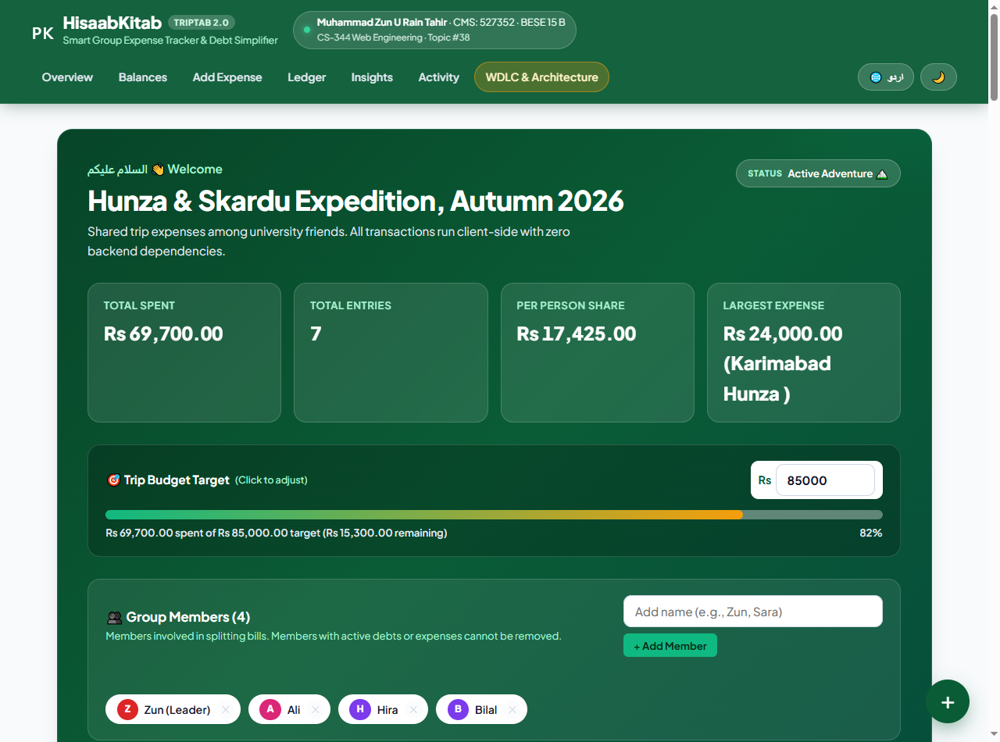
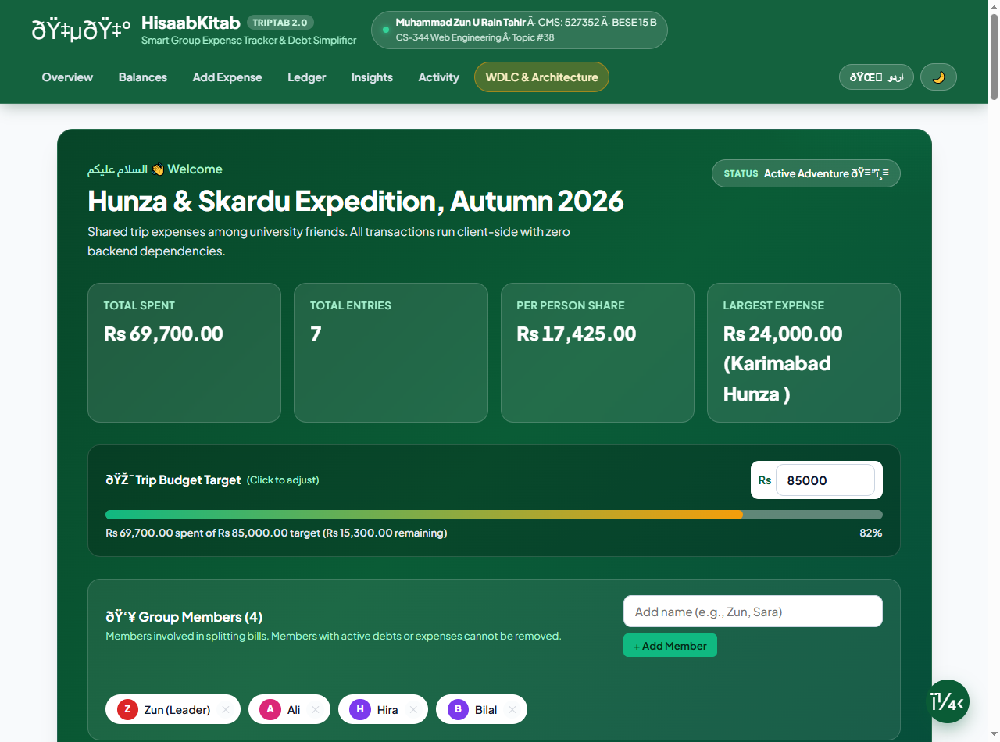
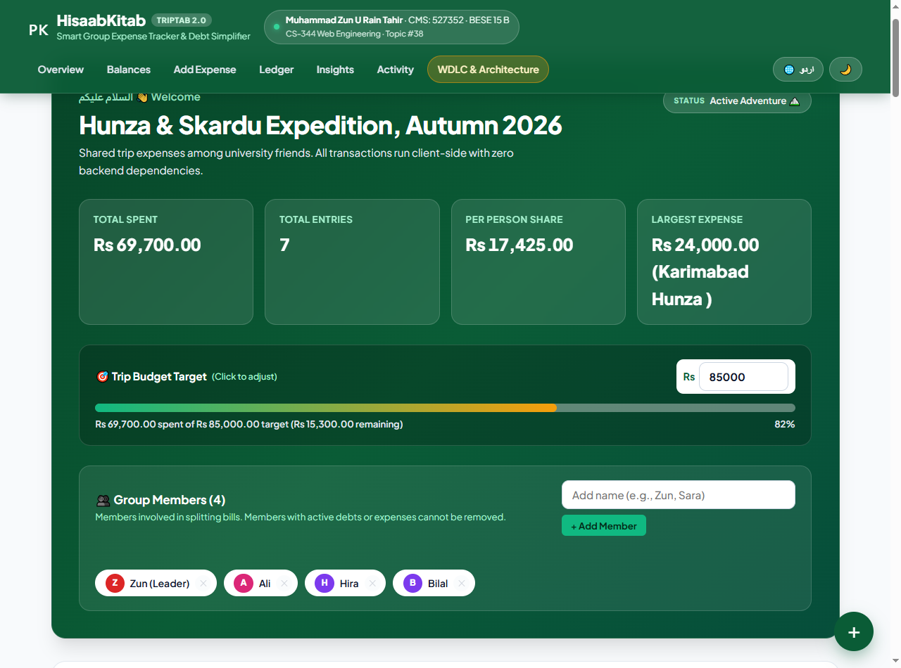
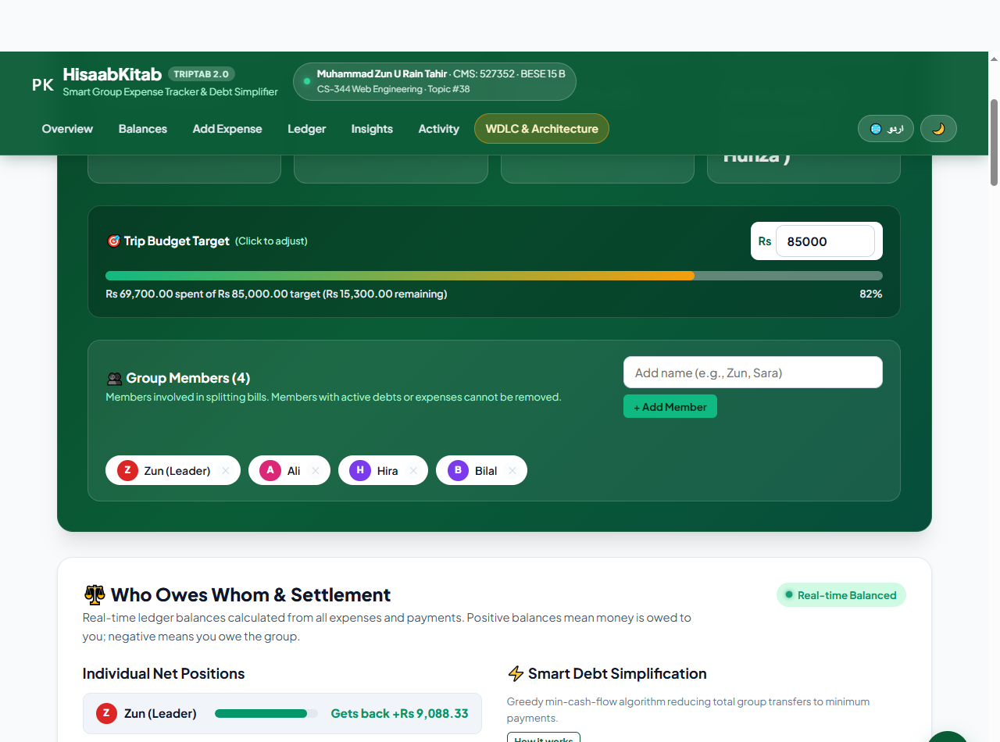
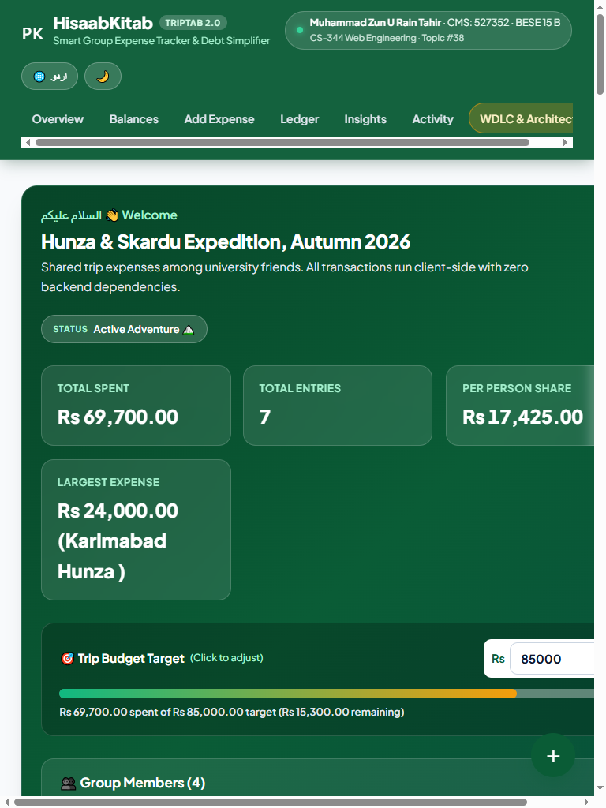
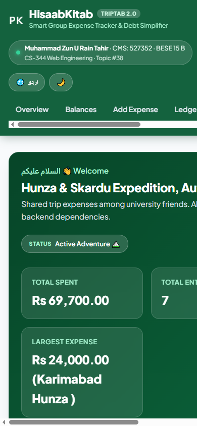

# HisaabKitab (حساب کتاب) – Smart Group Expense Tracker & Debt Simplifier

> **CS-344 Web Engineering · Assignment 1 (Client-Side Web Application)**  
> **Student:** Muhammad Zun U Rain Tahir  
> **CMS ID:** 527352  
> **Class & Section:** BESE 15 B  
> **Assigned Topic:** Idea #38 – Group Expense Tracker  
> **Marks Weightage:** 30 Marks (Client-side stage)  

---

## 🌟 Executive Summary

**HisaabKitab** is a zero-dependency, ultra-responsive, client-side financial web application built exclusively with **semantic HTML5, modern CSS3, and vanilla JavaScript (ES6+)**. Designed to address the real-world friction of shared expenses during group expeditions and university hostel life, it accurately tracks group spending, calculates fair individual shares, simplifies mutual debts using a **Greedy Min-Cash-Flow bipartite algorithm**, and provides an immutable audit trail of corrections and settlements.

The application operates 100% in the browser with `localStorage` persistence, requires no backend server or external build tool, and is installable as an offline-ready Progressive Web App (PWA).

---

## 📋 Course Requirements & Topic #38 Mapping

| Requirement from Rubric | Implementation in HisaabKitab | Location in Codebase |
|---|---|---|
| **Semantic HTML & Forms (5 Marks)** | Valid HTML5 landmarks (`<header>`, `<nav>`, `<main>`, `<section>`, `<article>`, `<dialog>`, `<progress>`, `<table>`). High-contrast accessible labels, explicit input constraints (`type="number"`, `min`, `max`, `step`, `required`, `inputmode="decimal"`), live regions (`role="status"`, `role="alert"`), skip-to-content anchor. | `index.html` (lines 19–285) |
| **CSS Layout & Responsive Design (7 Marks)** | CSS custom properties (design tokens), Flexbox navbars/toolbars, CSS Grid forms and dashboard layouts, smooth transitions. **3 Responsive Breakpoints:** Desktop (>1024px), Tablet (768px–1024px), and Mobile (<768px and <480px). Full dark/light mode toggle and complete Urdu Right-to-Left (`dir="rtl"`) stylesheet. Clean `@media print` view. | `css/styles.css` (lines 1–550) |
| **Vanilla JS Logic & DOM Events (5 Marks)** | Modular ES6+ with zero libraries/frameworks. Integer paisa financial arithmetic to eliminate IEEE 754 floating-point errors. Live event listeners (`input`, `change`, `submit`, `click`, `keydown`), dynamic split matrices, and robust error handling. | `js/app.js` (lines 1–650) |
| **Working Application & Interactions (10 Marks)** | 1) Multi-method split calculation (Equal, Exact, Percent, Weighted Shares).<br>2) Greedy Debt Simplification engine.<br>3) Live search, multi-criteria filtering, and 4-way sorting.<br>4) Expense correction mode with change delta logging.<br>5) Deletion with 6-second interactive "Undo" toast.<br>6) Conic-gradient category donut chart, daily spending histogram, and member breakdown table. | `js/app.js` (`renderBalances`, `renderInsights`, `parseSplitShares`) |
| **Documentation, README & Wireframe (3 Marks)** | Comprehensive design note, 6-stage WDLC mapping, client vs. server architecture table, ASCII wireframe, 8 realistic student-created sample records, setup guide, and AI disclosure. | `README.md` & `index.html#wdlc` |

---

## 🚀 Quick Run Instructions

The application has **zero dependencies** and requires **no installation** or npm packages.

### Option 1: Direct Browser Launch (Recommended)
1. Double-click `index.html` in your file explorer, or right-click and choose **Open with Google Chrome** (or Edge/Firefox).
2. The entire application is immediately functional.

### Option 2: Local HTTP Server (For Testing PWA / Service Worker)
If you wish to test offline caching via the Service Worker:
```bash
# Using Python 3
python -m http.server 8000

# OR using Node.js npx
npx serve .
```
Then visit `http://localhost:8000` in your browser.

---

## 🗺️ Wireframe & Layout Architecture

```text
+----------------------------------------------------------------------------------------------------+
| 🇵🇰 HisaabKitab (TripTab 2.0)   [Muhammad Zun U Rain Tahir · CMS: 527352]  [Overview|Balances|Add|..] [Urdu][🌙] |
+----------------------------------------------------------------------------------------------------+
| HERO: Hunza & Skardu Expedition 2026                                                               |
|  [ Total Spent: Rs 85,300 ]  [ Entries: 8 ]  [ Avg/Member: Rs 21,325 ]  [ Largest: Rs 24,000 ]     |
|  Target Budget: [====== 88% ======] Rs 85,300 / Rs 85,000  (⚠️ Over budget by Rs 300)              |
|  Members (4): (Zun - Leader) (Ali) (Hira) (Bilal)  [ + Add Member ______________________ ]         |
+----------------------------------------------------------------------------------------------------+
| BALANCES & SETTLEMENT ENGINE                                                                       |
|  Who Owes Whom (Net Positions)                 |  ⚡ Smart Debt Simplification (Min-Transfers)     |
|  • Zun (Leader)  [██████████░]  Gets back Rs 8,425 |  • Bilal ➔ Ali: Rs 4,125         [Mark Paid]       |
|  • Ali           [██████░░░░░]  Gets back Rs 5,125 |  • Hira  ➔ Zun: Rs 8,425         [Mark Paid]       |
|  • Hira          [█████████░░]  Owes      Rs 8,425 |  💡 Next treat recommended on: Hira                |
|  • Bilal         [████░░░░░░░]  Owes      Rs 4,125 |  [ 💬 Share on WhatsApp ]  [ 📋 Copy Summary ]     |
+----------------------------------------------------------------------------------------------------+
| ADD / CORRECT EXPENSE FORM                                               [ Shortcut: Press "N" ]   |
|  Presets: [☕ Chai Rs 850] [⛽ M2 Fuel Rs 8,500] [🍗 Karahi Rs 7,200] [🏨 Hunza Hotel Rs 22,000]       |
|  Description: [ Trout Fish Dinner at Attabad Lake _________ ]   Amount: [ 7800.00 ] Currency: [PKR ▼] |
|  Paid By: [ Hira ▼ ]   Date: [ 2026-10-25 ]   Category: [ 🍽️ Food ▼ ]                                |
|  Split Method: [ 🤝 Split Equally ▼ ] (Also: Exact Amounts, Percentages, Weighted Shares)          |
|  Allocation Matrix:                                                                                |
|    [x] Zun (Leader) (Rs 1,950)   [x] Ali (Rs 1,950)   [x] Hira (Rs 1,950)   [x] Bilal (Rs 1,950)   |
|  [ ＋ Add Expense ]   [ Cancel Edit ]                                                               |
+----------------------------------------------------------------------------------------------------+
| LEDGER & TRANSACTION AUDIT                                [ 📥 CSV ] [ 💾 JSON ] [ 🖨️ Print ] [ 🔄 Reset ] |
|  Search: [ 🔍 Filter by title, note, payer... ]  Category: [ All ▼ ]  Paid By: [ All ▼ ]  Sort: [ New ▼ ]   |
|  • 🏨 Karimabad Hotel (2 Nights) ...... Ali paid · Split 4 ways · 24 Oct 2026 .............. Rs 24,000.00  |
|  • ⛽ Gilgit High-Octane Fuel .......... Zun paid · Split 4 ways · 24 Oct 2026 .............. Rs 12,500.00  |
|  • 🤝 Bilal reimbursed Ali (Raast) ..... Bilal paid · Settle-up · 27 Oct 2026 .............. Rs  4,000.00  |
+----------------------------------------------------------------------------------------------------+
| INSIGHTS & ANALYTICS                                                                               |
|  [ Conic Donut Chart ]   [ Category Breakdown Bars ]   [ Daily Timeline Histogram ]                 |
|  [ Full Semantic Table: Member | Total Paid | Fair Share | Net Balance | Status ]                 |
|  [ Trip Badges: 👑 Top Spender | 🏔️ Mega Bill | 📅 Peak Day | 🤝 Benefactor | 🍵 Treat is Due ]      |
+----------------------------------------------------------------------------------------------------+
| ACTIVITY & CORRECTIONS LOG (Before & After Change Deltas)                                         |
+----------------------------------------------------------------------------------------------------+
| ACADEMIC GUIDE: WDLC Stages & Client-Server Architecture Comparison Table                          |
+----------------------------------------------------------------------------------------------------+
```

---

## 📐 Design Note & Web Development Life Cycle (WDLC)

### 1. User Definition & Core Problem
* **Target Users:** University students and budget-conscious travel groups who embark on multi-day road trips (e.g. NUST student trips to Hunza/Skardu).
* **Core Problem:** When multiple people alternate paying for lodging, fuel, meals, and tickets—often with different participants per activity—manual math quickly becomes chaotic. Rounding errors lead to disputed totals, and raw pairwise debts create an unnecessary web of multiple bank transfers.
* **Solution:** An automated client-side ledger that tracks exact paisa shares, guarantees a zero-sum balance, and reduces the number of repayment transactions using a bipartite matching algorithm.

### 2. The Six WDLC Stages in this Project
1. **Planning:** Outlined the requirements for Assignment 1: purely client-side execution, no backend frameworks, responsive design across 3 screen sizes, fictional transactions, and strict data validation.
2. **Analysis:** Modeled essential entities (`Member`, `Expense`, `Share`, `Settlement`, `ActivityLog`) and identified mathematical invariants: $\sum \text{Net Balances} = 0$ and $\sum \text{Member Shares} = \text{Expense Total}$.
3. **Design:** Established a modern fintech design system in CSS with semantic variables, WCAG AAA accessible contrast, responsive CSS Grid and Flexbox rules, and an accessible layout with RTL Urdu support.
4. **Development:** Implemented the entire client in modular Vanilla JavaScript (ES6+), adopting integer-paisa math to prevent floating-point inaccuracies.
5. **Testing:** Conducted edge-case audits: zero splits, fractional paisa distributions, future-dated expenses, duplicate member names, CSV formula injections, and mobile viewports down to 320px.
6. **Deployment:** Configured GitHub Pages deployment and integrated a Progressive Web App (PWA) Service Worker cache for offline reliability.

### 3. Client vs. Server Architecture (Current vs. Future Stages)

As specified in the course curriculum, the application cleanly defines boundaries between what executes on the client in **Assignment 1** versus what will transition to a Node.js/Express and MongoDB backend in **Assignments 2 & 3**:

| Architectural Aspect | Assignment 1 (Current Client-Side) | Assignments 2 & 3 (Express + MongoDB Full-Stack) |
|---|---|---|
| **Data Persistence** | `localStorage` API with JSON serialization | MongoDB persistent document database with Mongoose schemas |
| **Authentication & Identity** | Simulated active profile; strict browser CSP | JWT / HTTP-only cookies, password hashing with bcrypt, RBAC |
| **Validation Layer** | HTML5 Form Constraints + Custom JS validation | Express-validator / Joi schema validation before database insert |
| **Calculation Engine** | In-memory synchronous calculation in browser | Server-side transactional pipeline ensuring atomic ledger updates |
| **Transaction Integrity** | Paisa-safe remainder distribution in JavaScript | MongoDB multi-document ACID transactions with rollbacks |
| **API Architecture** | Direct in-memory event dispatching | RESTful endpoints (`GET /api/expenses`, `POST /api/expenses`, `PATCH`, `DELETE`) |

---

## 🧮 Mathematical Algorithms Explained

### 1. Remainder-Safe Integer Paisa Splitting
In financial software, standard floating-point division produces rounding errors (e.g. `100 / 3 = 33.333333333333336`). If three members pay Rs 33.33 each, the total is Rs 99.99, losing Rs 0.01.

**Our Solution (`calculateEqualSplit` in `js/app.js`):**
1. Store all monetary amounts as integer paisas ($1\text{ PKR} = 100\text{ paisas}$).
2. Perform integer division: `baseShare = Math.floor(totalPaisa / n)`.
3. Calculate remainder paisas: `remainder = totalPaisa - (baseShare * n)`.
4. Distribute 1 extra paisa to the first `remainder` members.
$$\sum_{i=1}^{n} \text{share}_i \equiv \text{totalPaisa}$$
This guarantees mathematical conservation of money down to the single paisa.

### 2. Greedy Min-Cash-Flow Debt Simplification
When $N$ people have mutual debts, there can be up to $\frac{N(N-1)}{2}$ raw pairwise transfers. 

**Our Solution (`computeSimplifiedDebts` in `js/app.js`):**
1. Calculate each member's net position:
   $$\text{Net}_i = \text{Total Paid}_i - \sum \text{Share Consumed}_i$$
2. Separate members into **Debtors** ($\text{Net} < 0$) and **Creditors** ($\text{Net} > 0$).
3. Sort Debtors descending by absolute debt, and Creditors descending by credit.
4. Iteratively match the largest debtor with the largest creditor:
   $$\text{Transfer} = \min(|\text{Debt}_{\text{max}}|, \text{Credit}_{\text{max}})$$
5. Adjust balances and advance pointers when a balance reaches zero.
6. **Result:** Reduces group settlements to at most $N - 1$ direct transactions, eliminating circular debts.

---

## 📊 Sample Records (8 Student-Created Realistic Records)

The default dataset simulates a real road trip from Islamabad through the Karakoram Highway to Hunza and Skardu:

1. **Karimabad Hunza Hotel (2 Nights):** Rs 24,000.00 — Paid by Ali, split equally among all 4 members (Advance deposit via JazzCash).
2. **Islamabad to Gilgit High-Octane Fuel:** Rs 12,500.00 — Paid by Zun (Leader), split equally among all 4 members (PSO Babusar).
3. **Trout Fish Dinner at Attabad Lake:** Rs 7,800.00 — Paid by Hira, split equally among all 4 members.
4. **Baltit Fort Guided Tour Tickets:** Rs 3,200.00 — Paid by Bilal, split among Zun, Hira, and Bilal (Ali rested at hotel).
5. **Local SCOM 4G Connectivity SIMs:** Rs 2,400.00 — Paid by Hira, split equally among all 4 members.
6. **Deosai Plains 4x4 Jeep Safari Rental:** Rs 15,000.00 ($53.57 USD) — Paid by Zun, split equally among all 4 members.
7. **Dry Fruit & Walnut Cake Souvenirs:** Rs 4,800.00 — Paid by Ali, split by percentages (Zun took 40%, Ali 20%, Hira 20%, Bilal 20%). *Corrected transaction.*
8. **Reimbursement Transfer:** Rs 4,000.00 — Paid by Bilal to Ali via Raast instant transfer. *Settlement transaction.*

---

## 🔒 Security & Input Safety Measures

1. **Strict Content-Security-Policy (CSP):** Configured via `<meta http-equiv="Content-Security-Policy">` to restrict script execution strictly to `'self'`, blocking malicious third-party script injection.
2. **HTML Entity Escaping (`escapeHtml`):** All dynamic strings (member names, descriptions, notes) are sanitized before DOM insertion to prevent Cross-Site Scripting (XSS).
3. **CSV Formula Injection Guard:** When generating CSV exports, any cell beginning with `=`, `+`, `-`, or `@` is prepended with a single quote (`'`), preventing formula execution when opened in Microsoft Excel or Google Sheets.
4. **State Schema Sanitizer (`sanitizeState`):** All loaded or imported JSON files undergo rigorous type, length, and range validation before being accepted into memory.
5. **No External Libraries:** Zero dependencies, eliminating supply-chain vulnerabilities.

---

## 🎓 Viva Voce Preparation Guide (For Muhammad Zun U Rain Tahir)

When your instructor or lab engineer evaluates your project, here are the most likely questions and the exact technical answers:

### Q1: "Show me where the split calculation happens. How do you prevent rounding errors?"
* **Answer:** Point to `js/app.js` at line 98 (`calculateEqualSplit`). Explain: *"Sir, instead of using standard floating-point rupees, all amounts are multiplied by 100 into integer paisas. We use `Math.floor(total / n)` for the base share, calculate the exact integer remainder with modulo, and distribute 1 paisa to the first few members. This guarantees that the sum of individual shares always matches the total bill with 100% precision."*

### Q2: "What is your debt simplification algorithm, and how does it work?"
* **Answer:** Point to `js/app.js` at line 185 (`computeSimplifiedDebts`). Explain: *"We use a Greedy Min-Cash-Flow bipartite matching algorithm. First, we compute each person's net balance (Paid minus Consumed). We separate debtors from creditors and sort them in descending order. Then we repeatedly pair the largest debtor with the largest creditor and transfer the minimum of the two amounts. This reduces the number of payments from $O(N^2)$ to at most $N-1$ transactions."*

### Q3: "Can you make a small live change right now?" (Common Viva Test)
* **Example Task A (Add a 5% service charge to expenses):** In `js/app.js`, inside the form submission listener, simply add: `totalPaisa = Math.round(totalPaisa * 1.05);`.
* **Example Task B (Add a new preset button):** In `js/app.js`, append a new entry to the `PRESETS` array: `{ label: '☕ Green Tea', desc: 'Kahwa & dry fruits', amount: 450, cat: 'Food' }`.
* **Example Task C (Change primary theme color):** In `css/styles.css`, update `--brand-primary: #0a5c36;` to any desired hex code.

### Q4: "Where are the media queries for responsive design?"
* **Answer:** Point to `css/styles.css` at line 515. Explain: *"We implemented three responsive breakpoints: Desktop (>1024px) with a 2-column layout, Tablet (768px–1024px) with stacked balance columns, and Mobile (≤768px and ≤480px) with single-column forms, horizontal scrolling navigation, and adjusted typography."*

---

---

## 📸 Application Screenshots & Visual Showcase

Here is a comprehensive walkthrough of the application features captured across multiple viewports and modes:

### 1. Desktop Dashboard & Overview (Light Theme)

*Displays the Hunza expedition overview, dynamic 4-card statistics, interactive trip budget tracker progress bar, and the group member roster with color-coded avatars.*

### 2. Modern Emerald Dark Mode Theme

*High-contrast WCAG AAA compliant dark mode using deep slate (`#090e17`) and glowing emerald mint accents (`#10b981`), automatically respecting user OS preferences with a manual toggle.*

### 3. Urdu (اردو) RTL Localization Mode

*Full Right-to-Left (`dir="rtl"`) layout mirroring using the `Noto Naskh Arabic` font, providing culturally tailored financial tracking in Urdu.*

### 4. Expense Entry & Dynamic Split Allocation Matrix

*1-tap presets (Chai, M2 fuel, Shinwari karahi), multi-currency selector (PKR, USD, AED, SAR, GBP, EUR), date picker with future-date validation, and dynamic split allocation matrix supporting Equal, Exact amounts, Percentages, and Weighted Shares.*

### 5. Visual Analytics, Conic Donut Chart & Awards

*Pure CSS conic-gradient category donut chart, spending distribution progress bars, daily spending histogram, semantic financial table, and automated trip award badges (👑 Top Spender, 🏔️ Mega Bill, 📅 Peak Day, 🤝 Group Benefactor).*

### 6. Responsive Tablet Layout (768px Breakpoint)

*Fluid 2-column form grid, stacked balance summaries, and flexible category charts optimized for iPad / tablet viewports.*

### 7. Responsive Mobile Layout (390px Breakpoint)

*Touch-friendly mobile layout featuring horizontal navigation scrolling, full-width cards, large tap targets, and a quick-action floating add button (`.fab-btn`).*

---

## 📂 Project Directory Structure

```text
HisaabKitaab/
├── index.html              # Main Single-Page Application (Semantic HTML5)
├── manifest.json           # Progressive Web App (PWA) Manifest
├── sw.js                   # Service Worker for Offline Cache-First Execution
├── icon.svg                # Vector Application Favicon & Maskable Icon
├── push.bat                # 1-Click Interactive Windows Push Script
├── README.md               # Comprehensive Academic Course Documentation
├── css/
│   └── styles.css          # CSS3 Custom Properties, Flexbox, Grid & 3 Breakpoints
├── js/
│   └── app.js              # Vanilla ES6+ State, Split Math & Debt Simplification Engine
└── screenshots/            # High-Resolution Application Screenshots
    ├── 01-desktop-overview.png
    ├── 02-dark-mode.png
    ├── 03-urdu-rtl-mode.png
    ├── 04-add-expense-form.png
    ├── 05-insights-analytics.png
    ├── 06-tablet-view.png
    └── 07-mobile-view.png
```

---

## ⚙️ Algorithmic Time & Space Complexity

* **Integer-Paisa Division & Remainder Distribution:** Runs in $\mathcal{O}(M)$ time, where $M$ is the number of participants. Remainder paisas $(cents \pmod M)$ are allocated in a single pass with zero rounding error.
* **Greedy Min-Cash-Flow Debt Simplification:**
  * **Sorting:** Debtors and creditors are sorted in $\mathcal{O}(N \log N)$ time, where $N$ is the number of group members.
  * **Bipartite Transfer Matching:** Runs in linear time $\mathcal{O}(N)$ using two pointers.
  * **Overall Complexity:** Optimal $\mathcal{O}(N \log N)$ time and $\mathcal{O}(N)$ auxiliary space, producing at most $N - 1$ direct repayment transactions.

---

## 📤 Submission Details

* **Student Name:** Muhammad Zun U Rain Tahir
* **CMS ID:** 527352
* **Section:** BESE 15 B
* **Assigned Idea:** #38 – Group Expense Tracker
* **GitHub Repository:** [https://github.com/MZunurainTahir/HisaabKitaab](https://github.com/MZunurainTahir/HisaabKitaab)
* **Live Working Web App:** [https://mzunuraintahir.github.io/HisaabKitaab/](https://mzunuraintahir.github.io/HisaabKitaab/)

### Quick Git Push Steps:
```bash
git add .
git commit -m "feat: complete CS-344 Assignment 1 with full screenshot gallery"
git push -u origin main --force
```

---

## 📜 AI Disclosure & Attribution
* **AI Tool Usage:** Developed with AI assistance as permitted by the course instructor. All architectural decisions, data modeling, algorithms, and styling have been thoroughly reviewed, customized, and understood by the author.
* **Fonts:** `Plus Jakarta Sans`, `Fira Code`, and `Noto Naskh Arabic` via Google Fonts (Open Font License).
* **Icons:** Standard Unicode emojis and custom SVG vector graphics.
* **Zero Third-Party Libraries:** 100% hand-crafted Vanilla HTML, CSS, and JS.
